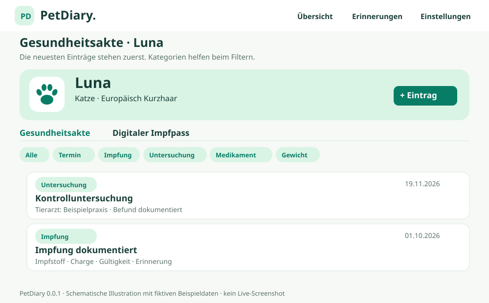
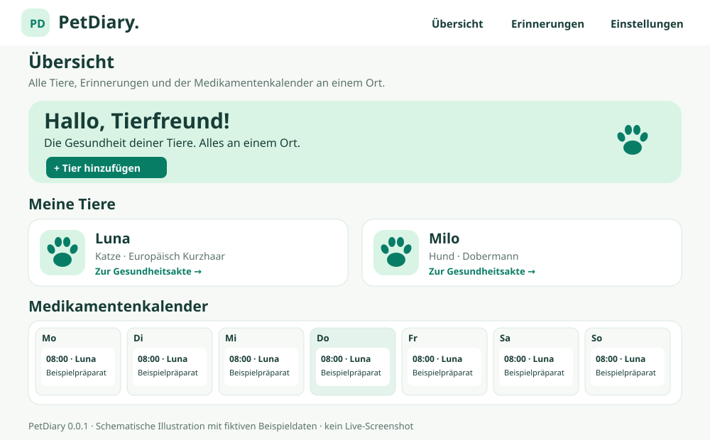
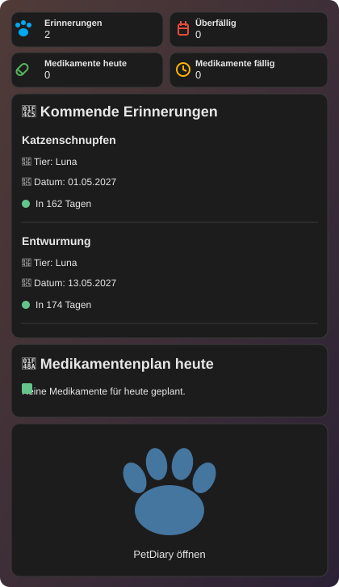

# 🐾 PetDiary 0.0.6 – Develop

**Self-hosted · Docker · SQLite · Home Assistant**


Private, ressourcenschonende Tiergesundheitsakte für den eigenen Docker-Server. Keine Cloud, kein JavaScript-Framework, keine zusätzliche Datenbank. Deutschsprachige Weboberfläche in Mintgrün und Petrol, inspiriert von modernen Tiergesundheits-Apps.

**Status:** Entwicklungsstand 0.0.6 – Kostenverwaltung, PDF-Gesundheitsakte und Dark Mode. Docker Hub stable/latest bleiben bei 0.0.5, bis ein neues Release veröffentlicht wird. Aktuelle Veröffentlichungen und Versions-Tags unter [GitHub Releases](https://github.com/Skoun181/PetDiary/releases) und [Docker Hub](https://hub.docker.com/r/skoun181/petdiary/tags). Ein lokales Administratorkonto pro Installation; keine Mehrbenutzerverwaltung.

[📖 Bebilderte Bedienungsanleitung](docs/USER_GUIDE.md) · [🏠 Home Assistant](docs/HOME_ASSISTANT.md) · [📦 Backup und Umzug](docs/BACKUP_MIGRATION.md) · [🔑 Passwort zurücksetzen](docs/PASSWORD_RESET.md) · [Änderungen](CHANGELOG.md)



Die Illustrationen zeigen fiktive Beispieldaten, keine live aufgenommenen Screenshots.

## Funktionen

- Mehrere Tiere mit eigenen Profilen und getrennten Akten
- Chronologischer Verlauf mit Kategorien für Termine, Impfungen, Untersuchungen, Befunde, Medikamente, Entwurmung, Gewicht, Ernährung, Notizen und Erinnerungen
- Einträge erstellen, bearbeiten und löschen; Tierarzt, Datum, Notizen, Präparat, Charge und Gültigkeit
- PDF- und Bildanhänge (JPEG, PNG, WebP), Inline-Vorschauseite mit optionalem Download; maximal 10 MB je Datei und fünf je Speichervorgang
- Digitaler privater Impfpass, orientiert am EU-Heimtierausweis: Halter, Tierdaten, Kennzeichnung, Ausweisnummer, ausstellende Praxis sowie Impf- und Vorsorgehistorie
- Erinnerungen für Termine und Impfungen, als erledigt markieren und wieder öffnen; Gültigkeitsende bei Impfungen als Standardfälligkeit
- Lesende REST-API für Home Assistant, Beispielkonfiguration und Dashboard-Karte
- Portables ZIP-Backup und -Import im Browser, inklusive Bilder/PDFs und automatischer interner Sicherheitskopie vor dem Import
- Browser-Ersteinrichtung, lokale Anmeldung, eigener API-Token, CSRF-Schutz, persistent gespeicherte SQLite-Daten, Non-Root-Container, Healthcheck

Der digitale Impfpass ist eine private Abschrift, keine amtliche Ausstellung und kein Ersatz für den Original-Heimtierausweis. Es werden keine medizinischen Impfintervalle berechnet und keine tierärztlichen Signaturen erzeugt. Weitere amtliche Sonderabschnitte sind noch nicht vollständig abgebildet. Es gibt noch keine Tierarztterminbuchung, Push-Nachrichten, einzelne Benutzerkonten.

## Tierprofile und Medikamentenkalender

- Eigene gestaltete, suchbare Vorschlagslisten mit Freitext: Tierart, passende Rassen, Geschlecht, Fellfarbe, Chip- und Tätowierungsposition; eigenes Merkmale-Feld.
- Eigene Profilbilder (JPEG, PNG oder WebP, maximal 5 MB), lokal in SQLite gespeichert.
- Lokaler Präparate-Startkatalog (keine vollständige oder amtlich abgeglichene Arzneimitteldatenbank). Eigene Präparate werden bei gespeichertem Eintrag zur Vorschlagsliste hinzugefügt. Geprüfte Varianten unter anderem für Milpro, Milbemax, Apoquel und Metacam ergänzen den Startkatalog. Die genaue eigene Präparatbezeichnung kann separat eingegeben werden; sie ersetzt beim Speichern die Auswahl. Name allein sagt nichts über Zulassung, Eignung oder Dosierung aus. Offizielle Recherche: [EU-Produktdatenbank](https://medicines.health.europa.eu/veterinary/de).
- Kategorie Medikament: bereits verabreichte Einzelgabe ohne Pflicht-Uhrzeit oder Kurdauer, optional mit Menge und Einheit. Bei Termin, Untersuchung oder Medikamenteneintrag können bis zu zwölf weitere Präparate mit individuellen Daten und Plänen hinzugefügt werden. Ein Medikamentenplan benötigt Präparat, Menge, Einheit, Startdatum und 1–3660 Tage; bis zu zwölf Uhrzeiten pro Tag sind optional. Ohne Uhrzeit wird eine tägliche Gabe ohne feste Uhrzeit erzeugt. Alle Tage und Uhrzeiten wiederholen sich gleich; unterschiedliche Mengen als getrennte Pläne dokumentieren. Keine automatisch vorgeschlagene Dosierung.
- Wochenkalender im Dashboard, nach Tier filterbar, einzelne Gaben als gegeben markieren bzw. wieder öffnen. Änderungen des Plans setzen dessen bisherige Häkchen zurück.
- Bestehende Datenbanken werden beim Start um die neuen Felder und Tabellen ergänzt. Vor Update Backup erstellen.

Bei Impfungen bedeutet Gültig bis das dokumentierte Ende des Impfschutzes bzw. der Nachweisgültigkeit, Erinnern am dagegen den gewünschten Erinnerungstag. Bei Medikamenten wird eine separate Erinnerung (z. B. Nachkontrolle) nur optional angezeigt; tägliche Gaben stammen aus dem Medikamentenplan. Bereits gespeicherte Zusatzfelder bleiben sichtbar und erhalten.

### Home Assistant – Medikamentenplan

GET /api/v1/medications?days=7 liefert geplante Gaben ab dem heutigen Tag (optional start=YYYY-MM-DD; days 1–31). Nutzt denselben Bearer-Token wie die Erinnerungs-API. Antwortfelder: count (offene Gaben im Fenster), due_count (bereits fällige offene Gaben im Fenster), next (nächste offene zukünftige Gabe oder null), medications (Liste mit stabiler id, record_id, pet_id, pet, title, product, dose, unit, day, time, scheduled_at mit Zeitzonenoffset (null ohne feste Uhrzeit), entry_id (zugehöriger Akteneintrag), done), timezone. Zeitumstellung: Uhrzeiten werden als lokale Kalenderzeit gespeichert, bei mehrdeutigen Zeiten gilt die erste Stunde; Sonderfälle bitte manuell prüfen. Eine Beispiel-REST-Konfiguration liegt unter examples/home-assistant-medications.yaml. Push-Automationen sind noch nicht Bestandteil der Anwendung.

### Präparatekatalog A–Z (0.0.3)

Der Katalog enthält 607 unterschiedliche Bezeichnungen (einschließlich vorhandener Präparatevarianten). Die bereitgestellten A–Z-Listen umfassen 343 Katzen- und 468 Hundeeinträge, zusammen 540 unterschiedliche Namen. 458 davon wurden neu ergänzt. Gemeinsame Handels- und Wirkstoffnamen werden nur einmal gespeichert. Die Vorschläge der Tierart erscheinen zuerst; Hinweise zeigen die Herkunftsliste und bewahren die Quellmarkierungen für Ergänzungs-/Pflegeprodukte, Humanarzneimittel bzw. mögliche Umwidmung und zu prüfende Varianten. Alle Einträge, auch unmarkierte, sind ungeprüft. Die Listen dienen ausschließlich der nachträglichen Dokumentation, nicht der Therapieauswahl. Freitext und bereits gespeicherte Namen sowie Pläne bleiben erhalten. Keine Dosierungen oder Indikationen aus den Listen übernommen. Permethrinhaltige Hundepräparate können für Katzen lebensgefährlich sein.

## Neue Funktionen in 0.0.6 (Develop)

### Kostenverwaltung
- Menü **Kosten** öffnen und **+ Kosten** wählen. Tier, Datum, Kategorie, Titel und Eurobetrag angeben.
- Bereits erhaltene Versicherungserstattung optional erfassen, später bearbeiten; Eigenanteil = Kosten minus Erstattung. Beträge werden als ganze Cent gespeichert.
- Nach Jahr oder Tier filtern; Gesamtausgaben, Erstattungen, Eigenanteil und Kategorieverteilung ansehen.
- Rechnungen als PDF/Bild am Akteneintrag hochladen und im Kostenformular mehrere Akteneinträge desselben Tieres per Checkbox auswählen (z. B. Impfung, Entwurmung und Medikamente auf einer Rechnung). Der Rechnungsbetrag zählt nur einmal. Kosten können auch ohne Akteneintrag angelegt werden.

### PDF-Gesundheitsakte
- Tierprofil öffnen und **PDF-Gesundheitsakte** anklicken.
- Die PDF enthält Profil-/Halterdaten, die chronologische Gesundheitsakte, Impfungen, Befunde, Notizen, Präparate, Medikationspläne und Erinnerungen. Anhänge werden namentlich aufgeführt, nicht eingebettet; Kosten und Zugangsdaten bleiben außen vor.
- Die PDF wird lokal erzeugt und kann gespeichert, ausgedruckt oder gezielt an eine Tierarztpraxis weitergegeben werden. Kein amtlicher Impfpass.

### Dark Mode
- Einstellungen → Erscheinungsbild → Design: System, Hell oder Dunkel.
- Die Auswahl wird im jeweiligen Browser gespeichert. Im Systemmodus folgt die App der Betriebssystemeinstellung.

## 📦 Backup erstellen, importieren und auf einen anderen Server umziehen (ab 0.0.5)

PetDiary kann die vollständige Tiergesundheitsakte direkt über den Browser als **portable ZIP-Datei** sichern und in einer neuen PetDiary-Instanz wiederherstellen – zum Beispiel bei einem Wechsel von Dockhand auf einen anderen Docker-Host oder in einen frischen LXC-Container. Die Funktion steht ab **Version 0.0.5** unter **Einstellungen → Daten sichern und umziehen** zur Verfügung.

### Was wird exportiert und importiert?

| Bestandteil | Im ZIP enthalten? | Nach dem Import |
| --- | :---: | --- |
| Tierprofile, Rasse, Kennzeichnung, Impfpass und Halterangaben | ✅ | Vollständig übernommen |
| Tierarztbesuche, Impfungen, Untersuchungen, Erinnerungen und Notizen | ✅ | Vollständig übernommen |
| Medikamente, Einzelgaben, dokumentierte Mengen, individuelle Pläne und Abhakstatus | ✅ | Vollständig übernommen |
| Profilbilder, angehängte Bilder und PDF-Dokumente | ✅ | Vollständig übernommen |
| Eigene Präparatenamen und gespeicherter Präparatekatalog | ✅ | Übernommen und mit dem aktuellen Grundkatalog ergänzt |
| Kosteneinträge und Erstattungen (ab 0.0.6) | ✅ | Vollständig übernommen, einschließlich Aktenverknüpfungen |
| Exportdatum (UTC), App-/Schema-Version, Tabellenanzahlen und SHA-256-Prüfsumme | ✅ | Zur Validierung genutzt |
| Admin-Benutzername, Konto und Passwort-Hash | ❌ | **Zugangsdaten der Zielinstanz bleiben erhalten** |
| Home-Assistant-API-Token und gespeicherter Token-Hash | ❌ | **Token der Zielinstanz bleibt erhalten** |
| Sitzungsschlüssel, Cookies und sonstige App-Secrets | ❌ | **Sitzungsschlüssel der Zielinstanz bleibt erhalten** |
| Docker-Image, Container, Docker-Volume oder Compose-Datei | ❌ | Separat auf dem neuen Server einrichten |
| Host-Port, Firewall, HTTPS-Proxy, .env und andere Servereinstellungen | ❌ | Bei Bedarf separat übernehmen oder neu einrichten |

**Gut zu wissen:** PetDiary speichert sämtliche hochgeladenen Dateien bereits in SQLite. Die ZIP-Datei enthält `petdiary.sqlite3` (bereinigte, konsistente Kopie inklusive Bilder/PDFs) und `manifest.json` (Metadaten/Prüfsumme). Es wird kein zweiter Dateiordner benötigt. Der Export enthält **keine** Zugangsdaten der Quellinstanz, aber weiterhin persönliche Tier- und Halterdaten. Bewahre ihn geschützt auf.

**Backup-Kompatibilität:** 0.0.6 exportiert Schema 3 und kann ältere Schema-1-ZIPs (0.0.5) und Schema-2-ZIPs (früherer 0.0.6-Stand) importieren. Bestehende Einzelverknüpfungen werden automatisch migriert. Beim Import eines alten Backups werden vorhandene Kostendaten der Zielinstanz ersetzt (leer). Schema-3-ZIPs sind nicht in älteren Versionen importierbar. Die browserlokale Designwahl ist nicht Teil des ZIPs.

### Schritt 1 – Daten in PetDiary exportieren

1. Melde dich in der **Quellinstanz** an (ab 0.0.5).
2. Gehe zu **Einstellungen → Daten sichern und umziehen → Daten exportieren**.
3. Gib dein **aktuelles Admin-Passwort** ein.
4. Klicke auf **ZIP-Backup herunterladen**. Währenddessen erscheint eine Statusmeldung.
5. Speichere die heruntergeladene Datei sicher, beispielsweise `petdiary-backup-2026-11-20-231200.zip`. Bewahre mindestens eine zusätzliche Kopie außerhalb des Servers auf.
6. **Wichtig bei Dockhand:** Wird eine Datei als `*.zip.tar` heruntergeladen, entpacke **nur das äußere TAR**. Importiere die darin enthaltene unveränderte `*.zip`-Datei.

Der Export nutzt die SQLite-Online-Backup-API, sodass kein laufender Container gestoppt werden muss. Die Größe ist auf **256 MiB ZIP** und **1 GiB entpackte SQLite-Datenbank** begrenzt. Für temporäre Dateien benötigt `/data` ausreichend freien Speicherplatz.

### Schritt 2 – Neue Instanz vorbereiten

Auf dem neuen Rechner Docker/Compose bzw. Dockhand bereitstellen. Für einen **neuen** Stack kannst du die [Docker-Hub-Compose-Vorlage](deploy/compose.yaml) verwenden. Beispielsweise:

~~~yaml
services:
  petdiary:
    image: skoun181/petdiary:0.0.5
    container_name: petdiary
    restart: unless-stopped
    ports:
      - "8080:8080"
    volumes:
      - petdiary-data:/data
    read_only: true
    tmpfs:
      - /tmp:size=64m,mode=1777
    cap_drop: [ALL]
    security_opt: [no-new-privileges:true]
    init: true
volumes:
  petdiary-data:
~~~

Speichere und deploye den Stack in Dockhand oder führe im Compose-Verzeichnis `docker compose up -d` aus. Öffne `http://NEUER-SERVER:8080` (oder deine HTTPS-Adresse) und lege auf der **neuen Instanz zuerst ein eigenes Admin-Konto** an. Der neue Container besitzt ein **eigenes** Volume. **Nicht** dasselbe produktive SQLite-Volume gleichzeitig in zwei schreibenden Containern einhängen.

### Schritt 3 – ZIP importieren

1. Melde dich auf der **Zielinstanz** an und öffne **Einstellungen → Daten sichern und umziehen → Backup importieren**.
2. Wähle das unveränderte `petdiary-backup-....zip` aus – **nicht** `.zip.tar`, die rohe `.sqlite3` oder ein Docker-Exportarchiv.
3. Gib das aktuelle **Passwort der Zielinstanz** ein.
4. Tippe zur Bestätigung exakt **ERSETZEN** und aktiviere das Kontrollkästchen.
5. Klicke auf **Backup importieren und Daten ersetzen**. Die Anwendung prüft Datei und Prüfsumme, SQLite-Integrität, Schema-Version und Fremdschlüssel, **bevor** sie Anwendungsdaten ändert.
6. Vor dem Überschreiben legt PetDiary automatisch eine interne vollständige Sicherheitskopie der bisherigen **Zieldatenbank** unter `/data/.petdiary-safety-backups/` an. Diese internen Notfallkopien enthalten bewusst die **alten Zugangsdaten der Zielinstanz** und sind **kein** portables Export-ZIP.
7. Nach erfolgreichem Import erscheinen eine Rückmeldung mit Anzahl der Tiere, Akteneinträge, Anhänge und Profilbilder sowie der Dateiname der Sicherheitskopie. Ein Containerneustart ist dafür nicht nötig.

**Achtung: Der Import ersetzt sämtliche vorhandenen Tier- und Gesundheitsdaten der Zielinstanz.** Er fügt nicht einfach Tiere hinzu. Wird der Vorgang während der Datenübernahme fehlerhaft, bleibt der bisherige Datenbestand dank SQLite-Transaktion erhalten. Das Admin-Konto und der Home-Assistant-Token **der Zielinstanz** werden nicht ersetzt.

### Schritt 4 – Umzug überprüfen

Prüfe nach dem Import die Tierprofile, Akteneinträge, Bilder/PDFs, Erinnerungen und den Medikamentenkalender. Kontrolliere bei Bedarf `http://NEUER-SERVER:8080/healthz`. Wenn sich Serveradresse oder Port geändert haben, passe Home Assistant, Reverse Proxy und Firewall an. Schalte den alten Server **erst nach erfolgreicher Kontrolle und einer zusätzlichen Sicherung** ab.

Für **bestehende Dockhand-Installationen**, die nur auf ein neues Image aktualisieren: **bestehendes Datenvolume beibehalten** und vorher ein Backup machen. Beim Aktualisieren per `docker compose pull && docker compose up -d` bleiben Daten im Volume erhalten. Niemals `docker compose down -v` zum Aktualisieren verwenden.

**Ältere Version 0.0.4:** Dort fehlt der Exportknopf noch. Für den einmaligen Umzug erklärt die [ausführliche Migrationsanleitung](docs/BACKUP_MIGRATION.md) das Erstellen eines SQLite-Online-Snapshots mit anschließender Umwandlung ins bereinigte PetDiary-ZIP.

**[Ausführliche Anleitung: Dockhand, bisherige 0.0.4, LXC, Notfall-Restore und technische Grenzen](docs/BACKUP_MIGRATION.md)**


## Installation

Voraussetzungen: Docker Engine, Docker Compose v2 bei Compose-Installationen, freier Port 8080. Kein externer Datenbankdienst und keine Pflicht-.env. Die Erstkonfiguration erfolgt im Browser. Der Quellcode ist öffentlich.

### A. Aus dem Git-Repository installieren

Mit GitHub CLI, auch bei Anmeldung über Google:

```sh
gh auth login
gh repo clone Skoun181/PetDiary -- --branch stable
cd PetDiary
docker compose up -d --build
```

Alternativ mit eingerichtetem Git-Zugriff:

```sh
git clone --branch stable https://github.com/Skoun181/PetDiary.git
cd PetDiary
docker compose up -d --build
```

Die mitgelieferte [compose.yaml](compose.yaml) baut das Image lokal. Sie verwendet einen benannten Docker-Datenträger unter /data. Für bestehende Entwicklungsinstallationen den bisherigen Projektordner und das bisherige Volume beibehalten; siehe Updates unten.

### B. Nur Docker Compose YAML (Docker Hub)

**Docker Hub:** Die Backup- und Importfunktionen sind ab dem Image-Tag `0.0.5` enthalten. Aktuelle Tags: [Docker Hub](https://hub.docker.com/r/skoun181/petdiary/tags). Bei einem privaten Paket benötigst du einen Docker-Hub-Token mit Leserechten.

Erstelle eine Datei `docker-compose.yaml` mit dem Inhalt der [Stack-Vorlage](deploy/compose.yaml):

```yaml
services:
  petdiary:
    image: skoun181/petdiary:latest
    container_name: petdiary
    restart: unless-stopped
    ports:
      - "8080:8080"
    volumes:
      - petdiary-data:/data
    read_only: true
    tmpfs:
      - /tmp:size=64m,mode=1777
    cap_drop:
      - ALL
    security_opt:
      - no-new-privileges:true
    init: true
volumes:
  petdiary-data:
```

```sh
docker compose up -d
```

### C. Docker Pull / Docker Run (Docker Hub)

```sh
docker pull skoun181/petdiary:latest
docker run -d --name petdiary --restart unless-stopped \
  -p 8080:8080 -v petdiary-data:/data \
  --read-only --tmpfs /tmp:size=64m,mode=1777 \
  --cap-drop ALL --security-opt no-new-privileges:true --init \
  skoun181/petdiary:latest
```

Das Pull-Kommando lädt nur das Image, startet aber keinen Container. Verwende die Run-Anweisung für den Start. Nicht parallel zur Compose-Installation ausführen; Containername und Port würden kollidieren.

### D. Portainer (Docker Standalone)

**Jetzt verfügbar – Image lokal bauen:**

1. Auf dem Ziel-Docker-Host das Repository wie in A klonen. Im Projektordner `docker compose build` (noch nicht up) ausführen. Dadurch entsteht `petdiary:local`.
2. In Portainer den entsprechenden Docker-Standalone-Endpunkt wählen, **Stacks → Add stack → Web editor**.
3. Stackname `petdiary` eingeben. Inhalt der [Stack-Vorlage](deploy/compose.yaml) einfügen und die Image-Zeile auf `image: petdiary:local` ändern. Kein erzwungenes erneutes Pull aktivieren.
4. **Deploy the stack**. Im Browser Port 8080 aufrufen.

**Docker-Hub-Installation:** Schritte 2–4 mit unveränderter Stack-Vorlage; vorher ggf. die private Docker-Hub-Registry in Portainer konfigurieren.

Optional kann ein Git-Stack mit der Repository-URL, Referenz `refs/heads/stable`, privaten Git-Zugangsdaten und Compose-Pfad `compose.yaml` eingerichtet werden, sofern die jeweilige Portainer-Installation Builds aus Git-Kontext unterstützt. Der lokal gebaute Image-Stack ist die Alternative.

Offizielle Anleitung: [Portainer – Add a new stack](https://docs.portainer.io/user/docker/stacks/add).

### E. Dockhand

**Jetzt verfügbar – Git-Stack:**

1. In Dockhand unter **Settings → Git** bei einem privaten Fork die Git-Zugangsdaten hinterlegen.
2. Unter **Stacks** einen Git-Stack mit der URL `https://github.com/Skoun181/PetDiary.git` erstellen.
3. Branch `stable`, Compose-Datei `compose.yaml`, Kontextverzeichnis Repository-Wurzel einstellen.
4. **Build images on deploy** aktivieren (notwendig für build: .) und deployen. Beim Einsatz eines Remote-Agenten Build-Unterstützung prüfen.

Alternativ Methode A nur bis zum lokalen Build ausführen und einen manuellen Stack mit der Stack-Vorlage und `image: petdiary:local` anlegen.

**Docker-Hub-Installation:** Unter Stacks **Create stack**, Name `petdiary`, unveränderte Stack-YAML einfügen, ggf. Registry-Zugang konfigurieren und deployen. Keine ENV-Zugangsdaten für PetDiary erforderlich.

Offizielle Anleitung: [Dockhand – Compose stacks](https://dockhand.pro/manual/).

### Develop – GitHub Container Registry (GHCR) in Dockhand

Der separate Workflow [Publish Develop to GHCR](https://github.com/Skoun181/PetDiary/actions/workflows/develop-publish.yml) baut bei Pushes auf den Branch `develop` nach erfolgreichen Python-Tests und Container-Starttests Images für AMD64 und ARM64. Der bestehende Stable-Release auf Docker Hub und dessen Tags bleiben unverändert. Develop ist eine Testversion, keine neue Stable-Freigabe.

1. Unter GitHub Actions prüfen, dass der neueste Publish-Workflow erfolgreich abgeschlossen ist.
2. In Dockhand unter Settings → Registries eine GHCR-Registry (`https://ghcr.io`) mit GitHub-Benutzername und Personal Access Token (classic) mit `read:packages` einrichten oder die vorhandene GitHub-Registry wiederverwenden. Der Benutzer muss Zugriff auf das Package haben. Neu angelegte GHCR-Packages sind standardmäßig privat.
3. Unter Images → Pull Image den Ziel-Docker-Host und die GHCR-Registry auswählen. Image: `skoun181/petdiary`, Tag: `develop`. Dockhand ergänzt `ghcr.io/` selbst; nicht doppelt eingeben.
4. Unter Stacks → Create stack einen separaten Stack `petdiary-develop` erstellen und die [GHCR-Compose-Vorlage](deploy/compose.develop.yaml) einfügen:

~~~yaml
# GHCR development preview; separate from the stable deployment.
name: petdiary-develop
services:
  petdiary:
    image: ghcr.io/skoun181/petdiary:develop
    container_name: petdiary-develop
    restart: unless-stopped
    ports:
      - "8081:8080"
    volumes:
      - petdiary-develop-data:/data
    read_only: true
    tmpfs:
      - /tmp:size=64m,mode=1777
    cap_drop:
      - ALL
    security_opt:
      - no-new-privileges:true
    init: true
volumes:
  petdiary-develop-data:
    name: petdiary-develop-data
~~~

5. Stack deployen. Bei einem bereits belegten Host-Port `8081` den linken Port ändern; der Container-Port bleibt `8080`. Keine ENV-Zugangsdaten, kein JWT_SECRET erforderlich.
6. `http://SERVER-IP:8081` im vertrauenswürdigen Netz öffnen und ein eigenes lokales Administratorkonto einrichten (Passwort mindestens zwölf Zeichen). Erst danach ggf. per HTTPS-Reverse-Proxy erreichbar machen.
7. Optional aus Stable ab 0.0.5 unter Einstellungen → Daten sichern und umziehen eine ZIP-Sicherung exportieren und auf Develop importieren. Das Zielkonto und dessen Home-Assistant-Token bleiben erhalten. Das produktive Volume niemals in der Develop-Instanz einhängen.

Für spätere Develop-Updates das Image erneut pullen und den Stack mit unverändertem Develop-Volume neu deployen. `develop` ist ein beweglicher Tag; ein erfolgreich veröffentlichter Commit kann auch über `sha-<vollständiger Commit-SHA>` gepinnt werden. Kein `docker compose down -v` ausführen.

Alternativ im Terminal:

~~~sh
docker login ghcr.io -u DEIN_GITHUB_USERNAME
docker pull ghcr.io/skoun181/petdiary:develop
~~~

Bei `manifest unknown` oder `not found` zunächst den Publish-Workflow, den Image-Pfad und den Package-Zugriff prüfen.

### F. Erststart für alle Installationsmethoden

Öffne `http://SERVER-IP:8080` (bei einem Reverse Proxy entsprechend die HTTPS-Adresse). Lege das lokale Administratorkonto an; Passwort mindestens 12 Zeichen. Anschließend ist die Ersteinrichtung gesperrt und es erscheint die reguläre Login-Seite. Unter Einstellungen verwaltest du dein Konto und den HA-API-Token.



**Sicherheit:** Die Beispielkonfiguration veröffentlicht Port 8080 auf allen Interfaces. Der erste Besucher kann das noch nicht eingerichtete Konto beanspruchen. Initial nur in einem vertrauenswürdigen Netz starten oder auf `127.0.0.1:8080:8080` beschränken und über einen SSH-Tunnel einrichten. Danach HTTPS-Reverse-Proxy verwenden, optional `COOKIE_SECURE=1` unter environment setzen, Netzwerkzugriff einschränken. Keine ungeschützte Internetfreigabe. Die Reverse-Proxy-Weiterleitung muss den HTTP-Port 8080 erreichen.

### Bestehende Installation aus der alten ENV-Version

Vor dem Upgrade ein Backup anlegen. Wenn bereits Tierdaten vorhanden sind, aber noch kein lokales Administratorkonto existiert, die alten ADMIN_USER, ADMIN_PASSWORD und API_TOKEN einmalig als Umgebungsvariablen über ein temporäres Compose-Override explizit bereitstellen. Die frühere .env allein wird nicht in den Container übernommen. Danach das Override und die Zugangsdaten entfernen. Bei vorhandenen Tierdaten ohne Admin-Konto und ohne alte Zugangsdaten verweigert PetDiary den Start, um eine Übernahme zu verhindern.

## Passwort vergessen?

```sh
docker exec -it petdiary python /app/reset_password.py
```

Das neue Passwort zweimal verdeckt eingeben. Alle Daten und der API-Token bleiben erhalten; alte Sitzungen werden ungültig. [Ausführliche Wiederherstellungsanleitung](docs/PASSWORD_RESET.md).

## Home Assistant

PetDiary besitzt eine integrierte lesende REST-API. Keine HACS-Erweiterung erforderlich. Die Dashboard-Karte zeigt nicht nur die Anzahl, sondern auch konkrete Erinnerungen mit Tiername, Datum und verbleibenden Tagen sowie Medikamentenname, Menge, Uhrzeit und Gabenstatus.



*Anonymisierte schematische Vorschau nach einem eingerichteten Dashboard.*

**[Ausführliche Schritt-für-Schritt-Anleitung mit vollständiger YAML](docs/HOME_ASSISTANT.md)**

### Schnellstart

1. In PetDiary unter **Einstellungen → Home Assistant** einen API-Token erstellen bzw. einen vorhandenen funktionierenden Token verwenden. Neue Tokens widerrufen den alten.
2. In der bestehenden HA-Datei `secrets.yaml` ergänzen:

```yaml
petdiary_url: "http://PETDIARY-SERVER:8080/api/v1/reminders?days=365"
petdiary_medication_url: "http://PETDIARY-SERVER:8080/api/v1/medications?days=1"
petdiary_authorization: "Bearer DEIN_API_TOKEN"
```

3. Serveradresse, ggf. Host-Port und Token ersetzen. HTTPS bevorzugen. Home Assistant muss den Zielport erreichen können (Firewall-Freigabe bei getrennten Netzen).
4. [Kombinierte REST-Konfiguration](examples/home-assistant-rest.yaml) in `configuration.yaml` übernehmen und mit einem eventuell vorhandenen `rest:`-Abschnitt zusammenführen. Bestehende Sensoren und andere Integrationen bleiben erhalten.
5. Unter **Entwicklerwerkzeuge → YAML** prüfen, Home Assistant neu starten und unter **Zustände** die vier Sensoren kontrollieren.
6. Im Dashboard **Bearbeiten → Karte hinzufügen → Manuell** wählen und die [fertige Dashboard-YAML](examples/home-assistant-card.yaml) einfügen. Entity-IDs bei Bedarf und URL in der letzten Zeile anpassen.

| Sensor | Inhalt |
| --- | --- |
| sensor.petdiary_erinnerungen | Offene Erinnerungen für 365 Tage inkl. überfälliger, Attribut reminders |
| sensor.petdiary_uberfallig | Überfällige Erinnerungen |
| sensor.petdiary_medikamente_heute | Offene Gaben heute, Attribut medications mit Details |
| sensor.petdiary_medikamente_fallig | Fällige offene Gaben heute |

Bei vorhandenen Installationen `days=30` in `secrets.yaml` auf `days=365` ändern und HA neu starten. Ein Sensorwert 0 bedeutet, dass keine entsprechenden offenen Einträge vorliegen. Leere Werte oder Nicht verfügbar erfordern eine Prüfung der API, Firewall und Protokolle (siehe Anleitung).

### API

- GET /api/v1/reminders?days=365 – Standard 365, frei wählbar 0–3650, offene überfällige Erinnerungen immer enthalten. next ist die früheste offene Erinnerung unabhängig vom Fenster. days_left ist negativ bei Überfälligkeit.
- GET /api/v1/medications?days=1 – Tagesplan; days 1–31, optional start=YYYY-MM-DD. Ohne feste Uhrzeit: time leer, scheduled_at null.
- Beide Endpunkte: Authorization: Bearer DEIN_API_TOKEN. Zeitzone standardmäßig Europe/Berlin.

Home Assistant kann eigene Benachrichtigungs-Automationen nutzen. PetDiary verschickt keine Push-Nachrichten; die API bleibt lesend, tatsächliche Gaben werden in PetDiary dokumentiert. Bei medizinisch kritischen Gaben nicht allein auf Polling vertrauen.

## Architektur, Backup, Betrieb

Ein Gunicorn-Worker mit zwei Threads, Flask, serverseitigem HTML und CSS, SQLite (WAL und Fremdschlüssel). Alle Daten inklusive Anhänge befinden sich in `/data/petdiary.sqlite3` im benannten Docker-Volume. Kein externer Datenbank- oder Cache-Dienst. Attachments werden als BLOB gespeichert, damit Datenbank-Backups konsistent bleiben; große Uploads erzeugen kurzfristig zusätzlichen RAM-Bedarf.

Konsistentes Online-Backup mittels SQLite Backup-API (nicht die laufende DB-Datei einfach kopieren):

```sh
docker compose exec -T petdiary python -c 'import sqlite3; s=sqlite3.connect("/data/petdiary.sqlite3"); d=sqlite3.connect("/data/backup.sqlite3"); s.backup(d); d.close(); s.close()'
docker compose cp petdiary:/data/backup.sqlite3 ./petdiary-backup.sqlite3
docker compose exec -T petdiary rm /data/backup.sqlite3
```

Backup geschützt aufbewahren: Es enthält auch die Anmelde-Hashes und das Session-Geheimnis. Für Restore Container stoppen, Datenbank in einem separaten Test-Volume wiederherstellen, Rechte UID/GID 10001 sicherstellen und erst nach Prüfung das Produktiv-Volume ersetzen. Nie `docker compose down -v` verwenden, wenn die Daten erhalten bleiben sollen.

Updates: Erst Backup anlegen und Volume beibehalten. Im bisherigen Projektordner einer Entwicklungsinstallation `git fetch origin && git switch stable` (wenn der Branch noch nicht lokal existiert, `git switch --track origin/stable`), dann `docker compose up -d --build`. Bei einer bestehenden Installation auf dem Release-Branch `git pull && docker compose up -d --build`. Bei einem veröffentlichten Image Versions-Tag bewusst aktualisieren, `docker compose pull && docker compose up -d`. Der Compose-Projektname bestimmt den Volume-Namen; nicht versehentlich einen zweiten Stack mit leerem Volume anlegen. Ressourcenverbrauch live mit `docker stats petdiary` messen. Keine validierten RAM-, Durchsatz- oder Stabilitätsbenchmarks vorhanden.

### Fehlersuche

```sh
docker compose ps
docker compose logs --tail=100 petdiary
curl -fsS http://127.0.0.1:8080/healthz
```

Bei Portkonflikten nur die linke Portnummer in der YAML ändern. Bei fehlenden Daten das tatsächlich gemountete Volume prüfen und kein neues Profil anlegen, bis die korrekte Datenbank wieder eingebunden ist. Bei leerer Oberfläche Browser-Cache aktualisieren. Der Healthcheck überprüft Erreichbarkeit und Datenbankzugriff, nicht sämtliche Anwendungsfunktionen.

## Entwicklung

```sh
python -m venv .venv
. .venv/bin/activate
pip install -r requirements.txt
python -m unittest discover -s tests -v
```

Die Tests nutzen eine temporäre Datenbank. Sie decken Grundfunktionen ab, ersetzen keine Lasttests, visuelle Browser-Tests oder Sicherheitsprüfung.

## Veröffentlichung (Maintainer)

Dauerhafte Branches: `stable` für die veröffentlichte Version, `develop` für Entwicklung. Neue Versionen erhalten einen Git-Tag `vX.Y.Z`, ein GitHub Release und passende Docker-Hub-Tags. Siehe [Release-Anleitung](docs/RELEASE.md).

## Referenzen

- [Home Assistant RESTful Sensor](https://www.home-assistant.io/integrations/sensor.rest/)
- [EU-Heimtierausweis / Reisen mit Haustieren](https://europa.eu/youreurope/citizens/travel/carry/pets-and-other-animals/index_de.htm)
