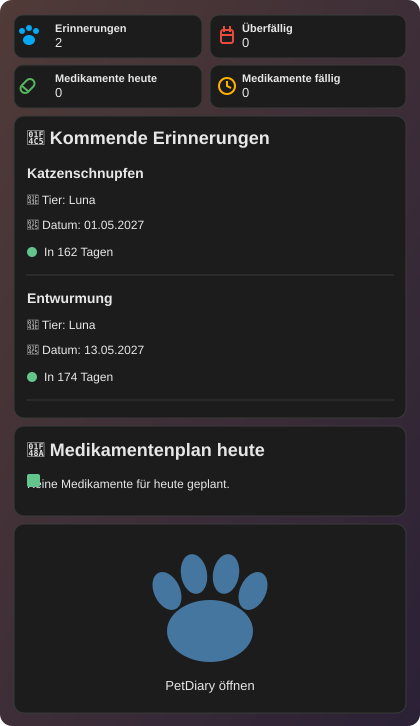

# 🏠 PetDiary mit Home Assistant verbinden

[Zurück zur README](../README.md)

PetDiary ab Version 0.0.4 liefert Erinnerungen für die kommenden 365 Tage (einschließlich offener überfälliger Erinnerungen) und geplante Medikamentengaben über eine lesende REST-API. Mit den integrierten REST-Sensoren und Standard-Dashboard-Karten von Home Assistant sind keine HACS-Erweiterung und keine weitere PetDiary-Installation nötig.



*Schematische Vorschau nach einem erfolgreich eingerichteten Dashboard im dunklen Design; fiktiver Tiername und Beispieltermine.*

## 1. Voraussetzungen

- Laufender PetDiary-Container und Home Assistant.
- Zugriff auf die HA-Konfigurationsdateien `configuration.yaml` und `secrets.yaml`, etwa File Editor oder Studio Code Server (bei HA OS) oder das gemountete Konfigurationsverzeichnis (Container).
- Home Assistant muss den PetDiary-Server über die veröffentlichte Adresse und den Host-Port erreichen können. Standard: TCP 8080. Bei getrennten Netzwerken eine gezielte Firewall-Freigabe nur von HA zum PetDiary-Host einrichten. HTTPS bevorzugen; keinen ungeschützten Zugriff aus dem Internet erlauben.

## 2. API-Token erstellen

In PetDiary **Einstellungen → Home Assistant** öffnen, aktuelles Passwort eingeben und **Token erstellen** wählen. Den angezeigten Token sicher kopieren; er wird nur einmal angezeigt. Ein neu erzeugter Token widerruft den vorherigen. Einen vorhandenen funktionierenden Token weiterverwenden.

## 3. secrets.yaml ergänzen

In der bestehenden Datei folgende Einträge hinzufügen bzw. vorhandene Werte aktualisieren:

```yaml
petdiary_url: "http://PETDIARY-SERVER:8080/api/v1/reminders?days=365"
petdiary_medication_url: "http://PETDIARY-SERVER:8080/api/v1/medications?days=1"
petdiary_authorization: "Bearer DEIN_API_TOKEN"
```

PETDIARY-SERVER durch die vom HA-System erreichbare Adresse ersetzen, ggf. Host-Port oder HTTPS-URL ändern. DEIN_API_TOKEN lokal einsetzen; das Leerzeichen nach Bearer muss erhalten bleiben. Token niemals in öffentliche Dateien, Screenshots oder Dashboard-YAML schreiben. Bereits bestehende Installationen mit days=30 auf days=365 umstellen.

## 4. configuration.yaml ergänzen

Die vorhandene Konfiguration (default_config, Automationen, Sensoren etc.) beibehalten. Die folgende vollständige REST-Konfiguration hinzufügen:

```yaml
rest:
  - resource: !secret petdiary_url
    headers:
      Authorization: !secret petdiary_authorization
    scan_interval: 300
    timeout: 10
    sensor:
      - name: "PetDiary Erinnerungen"
        unique_id: petdiary_reminders
        value_template: "{{ value_json.count }}"
        json_attributes:
          - reminders
          - next
          - overdue
          - due_today
          - as_of
        icon: mdi:paw
      - name: "PetDiary Überfällig"
        unique_id: petdiary_overdue
        value_template: "{{ value_json.overdue }}"
        icon: mdi:calendar-alert

  - resource: !secret petdiary_medication_url
    headers:
      Authorization: !secret petdiary_authorization
    scan_interval: 60
    timeout: 10
    sensor:
      - name: "PetDiary Medikamente heute"
        unique_id: petdiary_medications_today
        value_template: "{{ value_json.count }}"
        json_attributes:
          - medications
          - next
          - due_count
          - timezone
        icon: mdi:pill
      - name: "PetDiary Medikamente fällig"
        unique_id: petdiary_medications_due
        value_template: "{{ value_json.due_count }}"
        icon: mdi:clock-alert-outline
```

Falls bereits ein oberster Schlüssel rest: existiert, nur die beiden Listenelemente darunter ergänzen, keinen zweiten rest:-Schlüssel anlegen. [Kombinierte YAML herunterladen](../examples/home-assistant-rest.yaml). Erinnerungen werden alle 300 Sekunden, Medikamentengaben alle 60 Sekunden abgerufen.

## 5. Konfiguration prüfen und neu starten

Unter **Entwicklerwerkzeuge → YAML** die Konfiguration prüfen, dann Home Assistant neu starten (kein Host-Neustart nötig). Unter **Entwicklerwerkzeuge → Zustände** nach petdiary filtern.

| Entität (üblicher Name) | Bedeutung |
| --- | --- |
| sensor.petdiary_erinnerungen | Offene Erinnerungen im 365-Tage-Fenster inkl. überfälliger; Attribut reminders enthält alle Details |
| sensor.petdiary_uberfallig | Überfällige offene Erinnerungen |
| sensor.petdiary_medikamente_heute | Offene Gaben heute; Attribut medications enthält geplante und erledigte Gaben |
| sensor.petdiary_medikamente_fallig | Bereits fällige offene Gaben heute |

Die tatsächlich vergebenen Entity-IDs prüfen und bei Bedarf in der Karte anpassen. 0 ist ein gültiger Wert, wenn nichts ansteht; leer, unknown oder unavailable ist kein erfolgreicher Abruf.

## 6. Dashboard-Karte hinzufügen

**Dashboard bearbeiten → Karte hinzufügen → Manuell** wählen. Den folgenden Code vollständig einfügen (oder [fertige Dashboard-YAML](../examples/home-assistant-card.yaml) kopieren). In der letzten Zeile die URL für die Schaltfläche PetDiary öffnen auf die vom eigenen Browser erreichbare Adresse ändern. Bei HTTPS entsprechend anpassen.

```yaml
# Als manuelle Dashboard-Karte einfügen. Entity-IDs und URL anpassen.
type: vertical-stack
cards:
  - type: grid
    columns: 2
    square: false
    cards:
      - type: tile
        entity: sensor.petdiary_erinnerungen
        name: Erinnerungen
        icon: mdi:paw
        color: primary
      - type: tile
        entity: sensor.petdiary_uberfallig
        name: Überfällig
        color: red
      - type: tile
        entity: sensor.petdiary_medikamente_heute
        name: Medikamente heute
        color: green
      - type: tile
        entity: sensor.petdiary_medikamente_fallig
        name: Medikamente fällig
        color: orange
  - type: markdown
    title: 📅 Kommende Erinnerungen
    content: |
      
      
      ⚠️ PetDiary ist derzeit nicht verfügbar.
      
      ✅ Keine offenen Erinnerungen.
      
      
      ### {{ r.title }}

      🐾 **Tier:** {{ r.pet }}

      📅 **Datum:** {{ as_timestamp(r.due) | timestamp_custom('%d.%m.%Y') }}

      
      🔴 Seit {{ r.days_left | abs }} Tagen überfällig
      
      🟠 Heute fällig
      
      🟡 In {{ r.days_left }} Tagen
      
      🟢 In {{ r.days_left }} Tagen
      

      ---
      
      
  - type: markdown
    title: 💊 Medikamentenplan heute
    content: |
      
      
      ⚠️ PetDiary ist derzeit nicht verfügbar.
      
      ✅ Keine Medikamente für heute geplant.
      
      
      ### {{ m.product }}

      🐾 **Tier:** {{ m.pet }}

      💊 **Menge:** {{ m.dose }} {{ m.unit }}

      🕒 **Uhrzeit:** {{ m.time or 'Keine feste Uhrzeit' }}

      
      ✅ Bereits verabreicht
      
      🔵 Einnahme geplant
      
      🟠 Noch ausstehend – fällig
      

      ---
      
      
  - type: button
    name: PetDiary öffnen
    icon: mdi:paw
    tap_action:
      action: url
      url_path: http://PETDIARY-SERVER:8080
```

Die Karte zeigt vier Summen, alle konkreten Erinnerungen mit Tier, Fälligkeitsdatum und verbleibenden Tagen sowie Medikamentenname, Menge, Uhrzeit und Gabenstatus. Tierprofile und Gaben werden weiterhin in PetDiary gepflegt und abgehakt. Bereits in der Praxis verabreichte Einzelgaben ohne Plan erzeugen keine offenen Medikamententermine.

## 7. Fehlersuche

| Beobachtung | Prüfen |
| --- | --- |
| Keine Sensoren | Konfigurationsprüfung, Neustart, nur ein rest:-Schlüssel |
| Timeout / Verbindung abgelehnt | IP, veröffentlichter Port, Firewall und Erreichbarkeit vom HA-System |
| HTTP 401 | Aktiver Token, vollständiger Bearer-Header in secrets.yaml |
| Leere Werte / nicht verfügbar | Einstellungen → System → Protokolle (rest); API-Antwort prüfen |
| Erinnerungen fehlen | days=365 in secrets.yaml, Erledigt-Status, HA nach Secret-Änderung neu starten |
| Karte zeigt keine Details | tatsächliche Entity-ID sowie Attribute reminders bzw. medications unter Zustände prüfen |

Zum manuellen Aktualisieren unter **Entwicklerwerkzeuge → Aktionen** im YAML-Modus:

```yaml
action: homeassistant.update_entity
data:
  entity_id:
    - sensor.petdiary_erinnerungen
    - sensor.petdiary_medikamente_heute
```

Wenn ein Terminal im HA-Netz verfügbar ist, kann man die API lokal testen (Token nicht in Chats oder Logs teilen; Shell-History beachten):

```sh
curl -i --max-time 10 -H "Authorization: Bearer DEIN_API_TOKEN" \
  "http://PETDIARY-SERVER:8080/api/v1/reminders?days=365"
```

HTTP 200 mit JSON zeigt einen erfolgreichen API-Abruf. HTTP 401 bei Browseraufruf ohne Token zeigt nur, dass der Endpunkt erreichbar ist. Ein Browser auf einem anderen Gerät beweist nicht die Erreichbarkeit von HA.

## 8. API und Benachrichtigungen

- GET /api/v1/reminders?days=365: Standard 365 Tage, days 0–3650; offene überfällige Erinnerungen sind immer enthalten; next ist die früheste offene Erinnerung, auch außerhalb des Fensters.
- GET /api/v1/medications?days=1: geplante Gaben heute; days 1–31, optional start=YYYY-MM-DD. Ohne feste Uhrzeit sind time leer und scheduled_at null; solche Tagesgaben gelten ab dem jeweiligen Tag als fällig. Beide Endpunkte benötigen denselben Bearer-Token.
- Standardzeitzone Europe/Berlin. Bei zeitkritischen Gaben nicht ausschließlich auf Polling-Automationen vertrauen.
- Eigene HA-Automationen können Push-Nachrichten mit der Companion-App auslösen. PetDiary verschickt selbst keine Push-Nachrichten. Die API ist nur lesend, Abhaken aus HA wird nicht unterstützt.

[Home Assistant REST-Integration](https://www.home-assistant.io/integrations/rest/) · [Markdown-Karte](https://www.home-assistant.io/dashboards/markdown/) · [Secrets](https://www.home-assistant.io/docs/configuration/secrets/)
