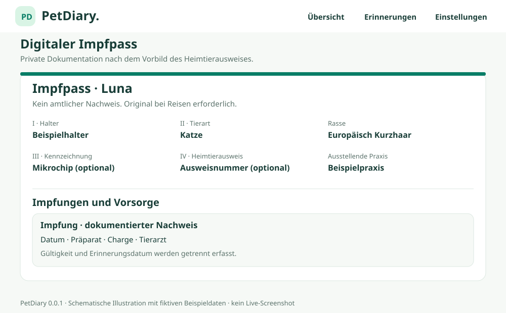

# PetDiary 0.0.6 – Bedienungsanleitung (Develop)

[Zurück zur README](../README.md) · [Passwort zurücksetzen](PASSWORD_RESET.md)

Die Bilder sind schematische Illustrationen auf Basis des Oberflächenaufbaus, keine Screenshots eines laufenden Containers. Namen und Inhalte sind fiktiv.

## 1. Ersteinrichtung und Anmeldung

1. Installiere PetDiary nach der [README](../README.md).
2. Öffne die Adresse deines Docker-Hosts mit Port 8080 im Browser.
3. Erstelle einmalig deinen lokalen Benutzernamen und ein Passwort mit 12–256 Zeichen. Bestätige es.
4. Du wirst auf die Übersicht weitergeleitet. Bei späteren Besuchen meldest du dich über die Login-Seite an.
5. Unter **Einstellungen** kannst du das Konto ändern, dich abmelden und einen API-Token erzeugen.

Keine Standard-Zugangsdaten, keine Pflicht-.env und keine Cloud-Anmeldung. Der erste Besucher kann die Ersteinrichtung beanspruchen. Richte den Dienst deshalb in einem vertrauenswürdigen Netz ein und verwende HTTPS für regulären Netzwerkzugriff.

## 2. Dashboard und Tiere

Das Dashboard zeigt die Tierprofile, den wöchentlichen Medikamentenkalender und offene Fälligkeiten der nächsten 365 Tage einschließlich überfälliger Einträge.

Wähle **+ Tier hinzufügen** und erfasse:

| Feld | Hinweise |
|---|---|
| Name und Tierart | Pflichtfelder; Tierart aus der Liste oder eigene Eingabe |
| Rasse | Vorschläge abhängig von Tierart; eigene Rassen zulässig |
| Geburtsdatum, Geschlecht | Optional; Geschlecht ist frei editierbar |
| Fellfarbe, Merkmale | Suchbare Farbliste; Merkmale separat als Freitext |
| Profilbild | JPEG, PNG oder WebP; maximal 5 MB |
| Mikrochip | Nummer, Kennzeichnungsdatum, Position; eigene Position möglich |
| Tätowierung | Zeichen/Nummer und Position |
| Halter und Heimtierausweis | Halter, Kontakt, Ausweisnummer, ausstellende Praxis und Datum |

Die suchbaren Vorschlagsfelder filtern beim Tippen. Pfeiltaste nach unten öffnet bzw. navigiert die Liste, Enter übernimmt den markierten Vorschlag, Escape schließt sie. Ein frei eingegebener Text bleibt bei editierbaren Feldern zulässig. Kategorien und Kalenderfilter sind feste Auswahllisten.

Speichere das Profil. Über **Profil bearbeiten** kannst du Angaben und Bild später austauschen oder das Bild entfernen. Weitere Tiere werden über die Übersicht hinzugefügt. Ein Tier zu löschen entfernt auch seine Einträge, Anhänge und Medikamentenstatus. Die Namensbestätigung schützt vor versehentlichem Löschen; es gibt keinen Papierkorb.

## 3. Gesundheitsakte

Öffne ein Tier und wähle **+ Eintrag**. Die Akte ist nach Ereignisdatum absteigend sortiert und nach Kategorien filterbar.

| Kategorie | Typische dokumentierte Angaben |
|---|---|
| Termin | Datum, Praxis, Anlass, Erinnerung |
| Impfung | Impfdatum, Impfstoff, Charge, Tierarzt, Gültigkeit |
| Untersuchung | Datum, Ergebnis, Gewicht, Tierarzt, Befund |
| Labor/Befund | Notizen, Untersuchungsergebnis, Dokument |
| Medikament | Präparat, verordnete Menge und Einnahmeplan |
| Entwurmung / Parasitenbehandlung | Datum, Präparat, Charge und Notizen |
| Gewicht | Gewicht in kg, Datum, Notizen |
| Ernährung | Futter, Beobachtungen, Verträglichkeit als Notiz |
| Notiz / Erinnerung | Titel, Datum, Beschreibung, optionales Erinnerungsdatum |
| Tollwut-Antikörpertest | Dokumentierte Nachweisgültigkeit, Befund |

Kategorie, Titel und Datum sind Pflicht. Die restlichen Angaben sind optional, außer bei einem ausdrücklich angelegten Medikamentenplan. Je nach Kategorie werden passende Zusatzfelder angezeigt. Bereits gespeicherte Zusatzangaben können weiterhin sichtbar sein.

Einträge lassen sich über **Bearbeiten** ändern. Beim Löschen werden die zugehörigen Anhänge und Gabe-Häkchen ebenfalls gelöscht.

### Dokumente und Befunde

Wähle eine oder mehrere Dateien im Akteneintrag aus. Unterstützt: PDF, JPEG, PNG, WebP. Pro Speichervorgang sind fünf Dateien von je maximal 10 MB möglich. Nach dem Speichern erscheint der Dateilink in der Akte. Öffne ihn für die Vorschau; der Download ist optional. PDFs benötigen die PDF-Unterstützung des Browsers. Im Bearbeitungsmodus können einzelne Anhänge gelöscht werden.

## 4. Digitaler Impfpass

1. Öffne die Tierakte und den Reiter **Digitaler Impfpass**.
2. Ergänze die Stammdaten des Heimtierausweises über **Ausweisdaten bearbeiten**.
3. Lege eine Impfung mit Datum, Präparat, Charge, behandelnder Praxis und dokumentierter Gültigkeit an.
4. Füge bei Bedarf ein Foto oder PDF des Nachweises an.
5. Trage unter **Erinnern am** einen gewünschten Termin ein. Ohne eigenes Datum wird bei Impfungen das Gültigkeitsende übernommen.

Beispiel: Der Nachweis ist bis 15.12.2027 gültig, erinnert werden möchtest du am 01.12.2027. Das sind unterschiedliche Angaben. PetDiary berechnet keine medizinischen Impfintervalle.

Der Bereich umfasst auch Vorsorgeeinträge wie Entwurmungen, Parasitenbehandlungen und Tollwut-Antikörpertests. Er ist eine private Abschrift und kein amtlicher EU-Heimtierausweis, keine tierärztliche Bescheinigung und kein Ersatz für erforderliche Originaldokumente bei Reisen.

## 5. Medikamentengaben und Kalender

Der Katalog enthält 607 unterschiedliche Bezeichnungen (einschließlich vorhandener Präparatevarianten). Die bereitgestellten A–Z-Listen umfassen 343 Katzen- und 468 Hundeeinträge, zusammen 540 unterschiedliche Namen. 458 davon wurden neu ergänzt. Gemeinsame Handels- und Wirkstoffnamen werden nur einmal gespeichert. Die Vorschläge der Tierart erscheinen zuerst; Hinweise zeigen die Herkunftsliste und bewahren die Quellmarkierungen für Ergänzungs-/Pflegeprodukte, Humanarzneimittel bzw. mögliche Umwidmung und zu prüfende Varianten. Alle Einträge, auch unmarkierte, sind ungeprüft. Die Listen dienen ausschließlich der nachträglichen Dokumentation, nicht der Therapieauswahl. Freitext und bereits gespeicherte Namen sowie Pläne bleiben erhalten. Keine Dosierungen oder Indikationen aus den Listen übernommen. Permethrinhaltige Hundepräparate können für Katzen lebensgefährlich sein.

Bei einem Termin oder einer Untersuchung kannst du über **+ Medikament hinzufügen** mehrere Präparate in demselben Eintrag speichern. Bei Kategorie Medikament gibt es ein Hauptpräparat und weitere Medikamentenblöcke. Wähle bei jedem Präparat **Bereits verabreicht**, wenn es direkt in der Praxis gegeben wurde: Uhrzeit und Dauer sind dann nicht nötig; Menge und Einheit sind optional. Es entsteht kein offener Kalendereintrag. Wähle für die weitere Behandlung **Medikamentenplan anlegen**. Jedes zusätzliche Präparat hat sein eigenes Datum, seine Menge, Einheit, Dauer und optional bis zu zwölf Uhrzeiten. Ohne Uhrzeit wird eine tägliche Gabe ohne feste Uhrzeit erstellt. Die Gabe kann trotzdem einzeln abgehakt werden.

1. Lege einen Eintrag mit Kategorie **Medikament** an.
2. Erfasse den Behandlungsbeginn und einen Titel.
3. Suche das konkrete Präparat einschließlich Stärke. Fehlt es, nutze die eigene genaue Präparatbezeichnung. Sie überschreibt die Auswahl und wird künftig vorgeschlagen.
4. Gib die vom Tierarzt verordnete Menge je Gabe, Einheit und Behandlungsdauer in Tagen an.
5. Trage die tatsächlichen Uhrzeiten ein, falls vorgegeben. Ohne Uhrzeit erscheint eine Gabe pro Tag. Über **+ Weitere Uhrzeit** sind bis zu zwölf Zeiten pro Tag möglich.
6. Speichere. Der Wochenkalender erzeugt die Gaben vom ersten Tag bis einschließlich des letzten Behandlungstags.

Ein Plan mit 14 Tagen und zwei eingetragenen Uhrzeiten ergibt 28 Kalendereinträge. Das ist eine reine Planungsrechnung, keine medizinische Empfehlung. Unterschiedliche Mengen, wechselnde Zeiten oder Unterbrechungen als getrennte Pläne abbilden. Derzeit unterstützt ein Plan identische tägliche Zeiten (oder eine Gabe ohne Uhrzeit) und Mengen für 1–3660 Tage. Für Dauermedikation müssen Pläne bei Bedarf verlängert werden.

Im Dashboard kannst du die Woche wechseln und nach Tier filtern. Markiere jede tatsächliche Gabe als gegeben. Ein Häkchen kann rückgängig gemacht werden. Änderungen am Plan (Präparat, Menge, Start, Dauer oder Uhrzeiten) setzen die bisherigen Häkchen dieses Plans zurück. Ändere abgeschlossene Verläufe daher nur bewusst.

Unter **Separate Erinnerung** kann zusätzlich ein Nachkontrolltermin eingetragen werden. Die täglichen Gaben benötigen kein zusätzliches Erinnerungsdatum.

Der lokale Präparatekatalog ist ein Startkatalog und keine vollständige behördliche Arzneimitteldatenbank. Die Produktstärke ist nicht die verordnete Dosierung. Die Eingabe und Verabreichung von Medikamenten erfolgen nach tierärztlicher Anweisung; PetDiary prüft keine Eignung, Wechselwirkungen oder Dosierungen.

## 6. Erinnerungen

Die Übersicht zeigt offene Fälligkeiten der kommenden 365 Tage und Überfälliges. Unter **Erinnerungen** findest du alle offenen datumsbasierten Fälligkeiten. Markiere eine Erinnerung als erledigt; der Akteneintrag bleibt erhalten. Du kannst sie beim Bearbeiten wieder öffnen. Zukünftige Termine erhalten standardmäßig den Termintag als Fälligkeit.

Medikamentengaben besitzen einen eigenen Status pro Uhrzeit und Datum im Kalender. Sie laufen getrennt von den datumsbasierten Erinnerungen.

## 7. Home Assistant

Die [ausführliche Home-Assistant-Anleitung](HOME_ASSISTANT.md) enthält alle Schritte: API-Token, secrets.yaml, kombinierte REST-Sensoren, Dashboard-Karte mit Erinnerungs- und Medikamentendetails, Netzwerk-/Firewall-Prüfung und Fehlerbehebung. Keine HACS-Erweiterung nötig.

Die Erinnerungs-API verwendet ohne days-Parameter 365 Tage. Bestehende HA-URLs mit days=30 in secrets.yaml auf days=365 umstellen und HA neu starten. Die API ist nur lesend. Gaben werden in PetDiary abgehakt, nicht in Home Assistant.

## 8. Einstellungen und Wartung

Unter Einstellungen änderst du Konto und API-Token. Das Passwort muss 12–256 Zeichen umfassen. Passwortänderungen machen frühere Sitzungen ungültig; der API-Token bleibt unabhängig davon gültig.

Wenn du das Passwort vergessen hast: [Passwort zurücksetzen](PASSWORD_RESET.md).

Zur Datensicherung, Wiederherstellung, Aktualisierung und Fehlersuche siehe [README](../README.md). Der derzeitige Stand ist eine Vorabversion, nicht medizinisch validierte Software. Kein Live-Docker-/Browser-Test oder Performancebenchmark ist dokumentiert.

## Datenexport und Wiederherstellung (ab 0.0.5)

Unter **Einstellungen → Daten sichern und umziehen** lässt sich ein portables ZIP mit allen Tier- und Gesundheitsdaten sowie Bildern/PDFs erstellen. Ein Admin-Passwort ist erforderlich; das ZIP enthält keine Admin-Konten, Passwort-Hashes, API-Token oder Session-Geheimnisse. Im selben Bereich können ZIP-Dateien geprüft und nach ausdrücklicher Bestätigung importiert werden. Der Import ersetzt die vorhandenen **Tierdaten** und legt vorher eine interne Sicherheitskopie der Ziel-Datenbank an. Die Zugangsdaten der Zielinstanz bleiben erhalten.

**Ab 0.0.5 auch in Stable verfügbar:** [Vollständige Schritt-für-Schritt-Anleitung für den Export, Import, Dockhand, alte 0.0.4-Installationen und Serverumzüge](BACKUP_MIGRATION.md). Beim Umzug müssen Image, Compose-Datei, Portfreigaben und das neue Volume separat vorbereitet werden; die ZIP enthält die Anwendungsdaten, nicht die Serverkonfiguration.

## Kosten (0.0.6)

Öffne Kosten → + Kosten. Erfasse Tier, Datum, Kategorie, Beschreibung und Betrag in EUR. Bereits erhaltene Erstattung ist optional; der Eigenanteil wird automatisch berechnet. Lade Rechnungen am Akteneintrag hoch und verknüpfe diesen im Kostenformular. Filtere die Übersicht nach Tier und Jahr. Einträge können bearbeitet oder gelöscht werden.

## PDF-Gesundheitsakte

Öffne ein Tierprofil und klicke auf PDF-Gesundheitsakte. Die lokal erzeugte Datei enthält Profil, Halterangaben und die chronologische medizinische Akte. Anhänge erscheinen als Dateinamen, nicht als eingebettete Originale. Kostendaten und Zugangsdaten sind ausgeschlossen. Das PDF enthält private Daten und ist kein amtlicher Impfpass.

## Erscheinungsbild

Unter Einstellungen → Erscheinungsbild wähle System, Hell oder Dunkel. Die Auswahl bleibt im jeweiligen Browser gespeichert.
